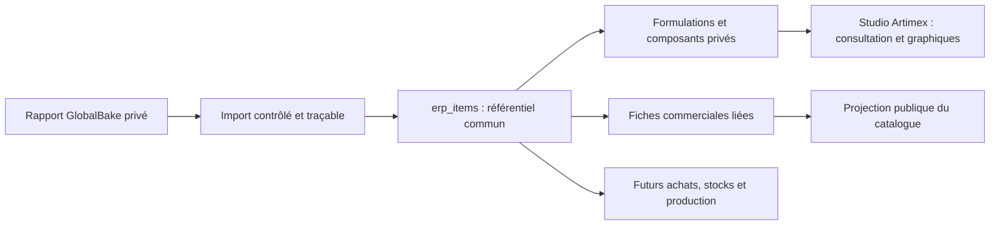

# Référentiel commun Artimex : boutique et futur ERP

Le référentiel métier est désormais indépendant de la boutique et des identifiants GlobalBake. `erp_items` identifie un article une seule fois ; les formulations et leurs composants utilisent ces mêmes identifiants. Une fiche commerciale `commerce_products` peut pointer vers cet article par une relation unique `item`, sans exposer ses recettes.



Il ne s’agit pas d’un moteur de production ou d’un remplacement complet de GlobalBake. Les tables et API posent le socle réutilisable. Aucune bascule, désactivation ou modification n’est effectuée dans GlobalBake.

## Séparation des responsabilités

| Table | Rôle |
| --- | --- |
| `erp_items` | Identité Artimex stable, nom source, rôle dans le rapport, classification, code GlobalBake confirmé éventuel, unité de base et notes privées |
| `erp_recipes` | Variante de composition, empreinte, total reporté, alertes et rendement encore inconnu |
| `erp_recipe_lines` | Composant lié au référentiel commun, pourcentage exact, texte et ligne d’origine ; quantité et unité opérationnelles laissées nulles |
| `erp_recipe_sources` | Lien formulation/fichier et toutes les occurrences originales regroupées |
| `erp_imports` | Fichier source privé, empreinte SHA-256, compte rendu et progression durable |
| `commerce_products.item` | Projection commerciale facultative liée à l’article commun ; noms ES/EN et présentation distincts des données de fabrication |

Un article peut être à la fois une référence du rapport et un composant. Il n’est pas créé une seconde fois pour remplir ces deux rôles. Les noms ne sont rapprochés que par égalité exacte après retrait des espaces périphériques et normalisation Unicode NFC. Les ressemblances, abréviations et fautes apparentes ne sont pas fusionnées automatiquement.

Les identifiants internes `ART-…` ne prétendent pas être des SKU GlobalBake. Le code ERP réel reste nul tant qu’il n’est pas fourni et confirmé. Les unités ne sont pas déduites des conditionnements inscrits dans les noms. Un changement ultérieur de code externe ne doit pas changer l’identité interne.

## Rapport fourni : `gb-products.xlsx`

Le rapport est daté du **17 novembre 2026** et a été importé dans l’environnement **dev**. Son contenu n’est pas ajouté à Git ou aux dossiers publics.

| Constat à l’import | Nombre |
| --- | ---: |
| Blocs du rapport | 385 |
| Références distinctes du rapport | 367 |
| Noms distincts utilisés comme composants | 282 |
| Articles communs uniques, références et composants réunis | 529 |
| Formulations non vides distinctes | 228 |
| Lignes de composants après regroupement des répétitions | 1 655 |
| Répétitions identiques regroupées | 16 |
| Références sans composition fournie | 141 |
| Produits ayant plusieurs compositions distinctes | 2 |
| Formulations contenant une autoréférence | 110 |
| Lignes reportées à 0 % conservées | 472 |

Ces comptes décrivent le fichier importé, pas une activité de ventes ou une quantité en stock. Le tableau de bord recalcule ses indicateurs depuis la base. Le graphique des composants compte leurs apparitions dans les formulations, variantes incluses ; il comprend aussi les composants d’emballage et fournitures non encore classifiés.

Le rapport contient des produits, ingrédients, emballages, fournitures et frais. Tous les articles arrivent **à classifier**. Un pourcentage nul n’est pas interprété comme une preuve d’emballage ou comme une absence opérationnelle ; il peut aussi résulter du niveau de détail du rapport. Une composition vide ne crée pas de recette fictive. Une autoréférence à 100 % est conservée comme information source et n’est pas exécutable.

Les pourcentages sont enregistrés en décimal avec trois décimales, accompagnés du texte source exact. Les totaux autour de 100 % restent tels que reportés ; aucune renormalisation ni conversion en pourcentage boulanger, poids, coût ou liste réglementaire d’ingrédients n’est effectuée. Les deux compositions différentes d’un même produit sont conservées comme variantes importées, sans choix arbitraire d’une recette active ou d’une chronologie métier.

## Import Excel et traçabilité

Le Studio propose **Importar formulaciones** : sélection du XLSX, analyse, compte rendu, puis import privé explicite. Le lecteur Python utilise uniquement la bibliothèque standard et ne lit que les valeurs des cellules. Il ne décompresse aucun fichier sur le disque. Macros, liens externes, formules, DTD et entités sont refusés ; taille compressée, volume décompressé, nombre d’entrées, nombre de lignes, taille des cellules et durée d’analyse sont limités.

L’empreinte du fichier identifie l’import. Les identifiants d’articles, formulations, lignes et liens de provenance sont stables. Un fichier déjà terminé renvoie le même travail. Un import interrompu peut être repris sans recréer les mêmes références ; les classifications, unités et notes déjà saisies ne sont pas écrasées. Les variantes nouvelles reçoivent un numéro supplémentaire pour l’article concerné.

Une formulation et ses lignes sont écrites ensemble via la relation imbriquée Directus. Le fichier entier n’est pas une transaction globale : un état interrompu reste visible et les étapes sont enregistrées. Le traitement est sérialisé dans une instance Studio. Aucun calcul de besoin ou réservation de stock ne lit ces recettes importées comme des recettes approuvées.

Le fichier original est conservé dans le dossier Directus privé **ERP · Fuentes privadas GlobalBake**, sur le volume persistant. La recette vérifie son SHA-256 après téléchargement authentifié. Le fichier et les tables ERP sont interdits à l’accès anonyme et à l’identité de lecture de la boutique.

## API réutilisable

Toutes les routes ci-dessous exigent la session privée Studio et la vérification de l’identité Directus. Les mutations vérifient l’origine. Une future interface ERP peut réutiliser ce contrat ; un accès inter-application nécessitera sa propre configuration d’identité et d’autorisation.

- `GET /api/erp/overview` : indicateurs et données des graphiques, sans indicateurs financiers inventés.
- `GET /api/erp/items` : recherche et pagination ; filtres par rôle dans le rapport et type d’article.
- `GET /api/erp/items/:id` : article, variantes et éventuelle fiche boutique liée.
- `PATCH /api/erp/items/:id` : classification, unité de base, code ERP confirmé et notes privées uniquement.
- `GET /api/erp/recipes` et `GET /api/erp/recipes/:id` : formulations, composants et origine ; consultation privée.
- `POST /api/erp/workbook/preview` et `POST /api/erp/workbook/commit` : fichier XLSX en base64, analysé à nouveau côté serveur avant import.
- `GET /api/erp/imports` et `GET /api/erp/imports/:id` : suivi et compte rendu.
- `POST /api/erp/items/:id/storefront` : prépare une fiche boutique en brouillon pour un article explicitement classifié « produit terminé ». Relation unique et reprise sans doublon. Aucun produit du fichier n’est publié automatiquement.

Le catalogue public continue d’utiliser une projection explicite de `commerce_products`. Il n’inclut ni la relation `item`, ni les pourcentages, ni les notes, ni les sources. Son compte technique n’a aucune permission sur les collections ERP. Les fichiers JavaScript publics contiennent les fonctions d’affichage, jamais les données du classeur.

## Initialiser, importer et vérifier

```sh
railway run --service directus --environment dev -- node cms/bootstrap.mjs
railway run --service directus --environment dev -- node cms/import-globalbake-workbook.mjs /chemin/gb-products.xlsx
npm run cms:check
npm run cms:test
railway run --service directus --environment dev -- node cms/studio/erp-live-check.mjs /chemin/gb-products.xlsx
```

Le script d’import utilise les variables du Directus **Artimex dev** vérifié, démarre temporairement le serveur applicatif local avec ce Directus, puis réutilise les mêmes routes privées que le Studio. Il ne copie pas le classeur dans le dépôt. Le script de recette ne modifie pas les données source ; ses essais de lien boutique utilisent uniquement ses propres articles QA, supprimés à la fin.

Le Dockerfile du Studio installe Python 3 depuis Alpine et copie le lecteur avec le service Node. Après création d’un volume Railway vide, le répertoire `/directus/uploads` doit appartenir à l’utilisateur `node` du conteneur Directus. Ce droit a été corrigé sur le volume dev existant par `railway ssh --service directus --environment dev -- chown node:node /directus/uploads` ; aucun accès public aux fichiers n’a été accordé.

## Prochaine étape métier

Pour construire les modules achats, stocks et production, confirmer la classification des articles, les codes de référence, les unités et conversions autorisées, les rendements de lot et les variantes de recette à utiliser. Il faudra ensuite des mouvements de stock traçables par dépôt/lot, les achats et coûts réels, et les ordres de fabrication. Les graphiques de marge, valorisation et prévisions dépendront de ces données réelles. La sortie de GlobalBake nécessitera une reprise et une recette métier dédiées.
